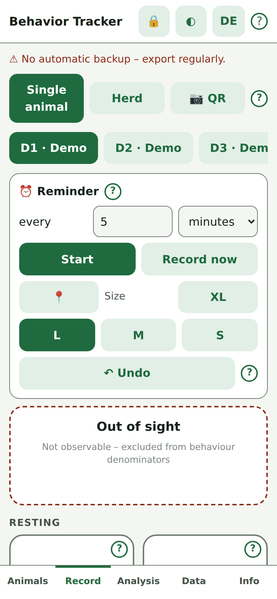

# Behavior Tracker (Verhaltens-Tracker)

A free, single-file web app for recording the behavior of **cattle, pigs and sheep** in the barn, on pasture or from video. Tap a button when a behavior starts, tap it again when it ends. The app stores start and end times and turns them into time budgets, daily patterns, bouts, transitions, synchrony and heatmaps.

Built for **farmers** (quick checks, welfare indicators) and **scientists** (ethogram editing, scan sampling, CSV/JSON export, BORIS-style output). Runs in any modern browser on phone, tablet or laptop — in English and German.

> **Try it online:** <https://jensharbers.github.io/AnimalObservation/Tierverhalten/>  
> No account, no installation. Your data never leaves your device.



*(All screenshots use generated demo data, not real animals.)*

---

## Highlights

- **One tap per behavior**, several behaviors at once (e.g. *Standing* + *Ruminating*), timers on every active button
- **32 built-in behaviors** in 8 groups, filtered by species — add your own, hide what you don’t need
- **Single-animal recording** and **herd scan sampling**
- **Reminder timer** (sound + vibration) that stores a snapshot of all animals
- **Analysis in the app:** duration tables, Gantt chart, welfare-indicator presets, five chart types, day/time heatmap
- **Export:** JSON, three CSV flavours, BORIS-like CSV, 1-second grid CSV, PDF/print report, ICS reminders, LaTeX Beamer ZIP
- **Merge colleagues’ data** from a JSON file
- **Field-ready:** outdoor mode, night mode, screen lock, wake lock, vibration, screen-reader support
- **Works offline** once the files are on your device

---

## Quick start

1. Open the [online version](https://jensharbers.github.io/AnimalObservation/Tierverhalten/).
2. **Animals** tab: enter a name and/or number, choose the species, tap **Add animal**.
3. **Record** tab: choose an animal, then tap behaviors as you see them. Tap again to end.
4. **Data** tab: tap **Export JSON** (or a CSV button) to save your data.

Want to explore first? **Data → ⚙ → Load demo data (6 cows, 2 days)**. Remove it again with **Remove demo data**.

**Illustrated walkthrough** with screenshots (setup → recording → herd scan → analysis → export, plus outdoor/night mode and screen lock):  
→ [`Tierverhalten/docs/VIGNETTE.md`](Tierverhalten/docs/VIGNETTE.md)

---

## Run it locally and offline

The app is a static page. Nothing to build, no server component.

**Option A — open the file**  
Download the repo and open `Tierverhalten/index.html` in a browser. Recording, analysis and export work.

**Option B — local server (recommended)**  
Some features (camera, GPS, service worker) need a secure context (`https://` or `http://localhost`):

```bash
cd Tierverhalten
python3 -m http.server 8000
# then open http://localhost:8000
```

**Option C — install like an app**  
Host the folder (e.g. GitHub Pages), open it in Chrome/Safari and use *Add to Home screen*. If `sw.js` is present, the service worker enables offline use.

**Fully offline (no network at all)**  
Keep these files next to the HTML so the app does not fall back to a CDN:

| File | Needed for |
|---|---|
| `lib/jszip.min.js` | ZIP export (Beamer folder) |
| `lib/jsQR.min.js` | QR scan without `BarcodeDetector` |
| `plotly-cartesian.min.js` | Heatmap |

Recording, tables, charts and CSV/JSON export need none of them.

---

## Built-in ethogram

32 behaviors, filtered by species of the selected animal (C = cattle, P = pig, S = sheep).

| Group | Behaviors |
|---|---|
| Resting | Lying, Standing (all) |
| Locomotion | Walking, Postural transition (all) |
| Feeding & drinking | Feeding, Drinking (all) · Grazing, Ruminating (C, S) · Rooting (P) · Browsing (S) |
| Maintenance | Grooming, Elimination (all) · Scratching (C) |
| Social | Social interaction, Aggression / fighting, Play (all) · Licking (C) · Mounting (C, P) · Tail biting (P) · Flocking, Isolation, Head butting (S) |
| Exploration | Exploration (all) · Nosing, Manipulating objects (P) |
| Maternal | Calf nursing (C) · Nesting, Suckling (P) · Lamb nursing (S) |
| Other | Other / unclassified (all) · Heat stress behavior (C) · Vigilance (S) |

Every behavior has a short definition and example behind its **?** button. You can export/import the ethogram (including definitions) as JSON.

---

## Data, export and backup

- Times are stored and exported in **UTC (ISO 8601)**. Heatmap bins use local wall clock.
- **JSON** = full data set (animals, events, scans, session metadata, ethogram).
- **CSV (events)** · **CSV (START/STOP)** · **CSV (scans)** — comma-separated, UTF-8.
- No automatic backup. Export regularly, especially before clearing browser data or switching devices.
- Multi-device: export on one device → **Merge colleagues’ data** on the other.

---

## Privacy

All data stays in the browser (`localStorage` + IndexedDB, soft limit ~15 MB). Nothing is sent to a server; no tracking, no account. Clearing browser data deletes your records — export first. GPS, camera and the optional backup file are only used when you enable them.

---

## Scientific notes and limitations

- The ethogram is a **practical starting point**, not a validated protocol. Adapt definitions to your question and document them for publication.
- Analysis views (especially the heatmap) are **exploratory**. Check *Coverage* before interpreting other metrics.
- Overlapping behaviors are counted separately, so shares can exceed 100 %.
- Welfare presets select behaviors from the ethogram; thresholds are left to you.
- Reminder timers and wake lock need the page to stay open.
- Storage is limited to roughly 15 MB. When full, the app asks you to export and delete old entries.

---

## Browser support and permissions

Current Chrome, Edge, Firefox and Safari (desktop, Android, iOS).

| Feature | Needs |
|---|---|
| QR scan | Camera + secure context (`BarcodeDetector` or jsQR) |
| GPS tagging | Location permission |
| Screen stays on | Screen Wake Lock API |
| Vibration | Vibration API (not on iOS Safari) |
| Secondary backup file | File System Access API (mainly Chrome/Edge) |
| Offline via service worker | Secure context + deployed `sw.js` |

---

## Third-party components

The app is MIT-licensed. It optionally loads three small libraries (local file first, CDN fallback):

| Library | Version | Used for | License |
|---|---|---|---|
| [JSZip](https://stuk.github.io/jszip/) | 3.10.1 | Beamer/LaTeX ZIP | MIT |
| [jsQR](https://github.com/cozmo/jsQR) | 1.4.0 | QR fallback | Apache-2.0 |
| [Plotly.js](https://plotly.com/javascript/) (cartesian) | 2.35.2 | Heatmap | MIT |

License texts are in `Tierverhalten/lib/licenses/`.

---

## License

[MIT License](LICENSE). Use, copy, modify and redistribute freely, including in research and commercial settings, as long as the copyright and license notice stay with it.

---

## Author and feedback

Jens Harbers · [harbers-agrarinformatik.de](https://harbers-agrarinformatik.de)  
Questions, ideas and bug reports → GitHub issues.
