# Vignette: a first observation day with the Behavior Tracker

This walkthrough follows one complete workflow, from setting up animals to exporting data, using the built-in **demo data** (6 cows, 2 days). All screenshots were taken on a phone-sized screen. No real animals or farms are shown.

Live version: <https://jensharbers.github.io/AnimalObservation/Tierverhalten/>
Back to the [README](../../README.md) for the full reference.

---

## Step 1: Set up animals and session

Open the **Animals** tab. Enter a name and/or number, choose the species and tap **Add animal**. The list below shows all animals and lets you filter or delete them.

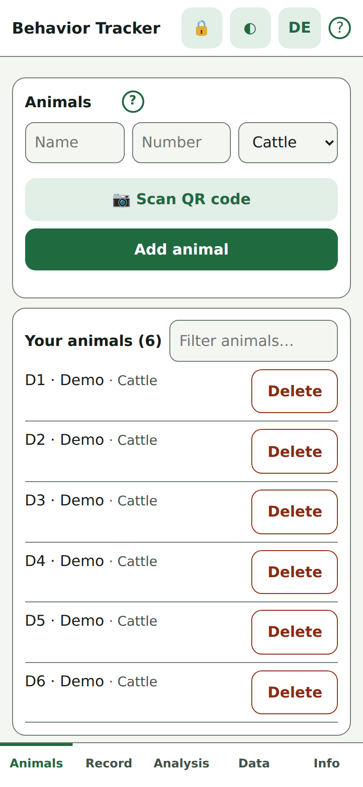

Scroll down to the **Session** card (study, observer, group/pen, location, temperature, housing system, day note) and the **Ethogram** editor. Session values are saved with every newly started event, so fill them in *before* you start recording.

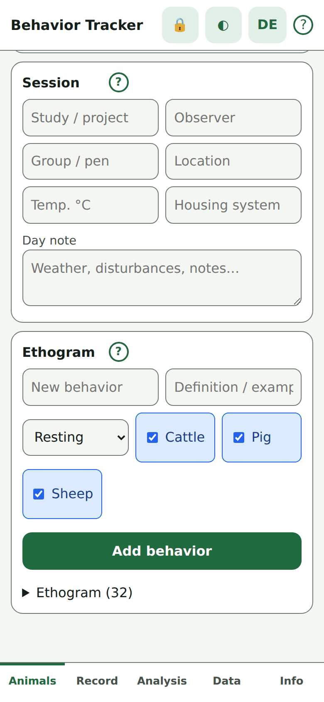

> **Tip:** Enter your name as *Observer*. It stays attached to your events when you later merge data from colleagues.

## Step 2: Record behavior

Switch to **Record**. Pick an animal in the chip row, then set the reminder and button size. Here the size is **L** (two buttons per row).

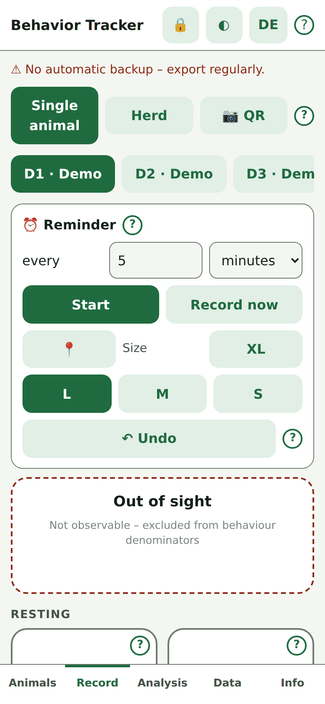

Tap a behavior to start it. The button turns green and counts up. Tap again to end it. Behaviors can overlap, e.g. *Lying* and *Ruminating*.

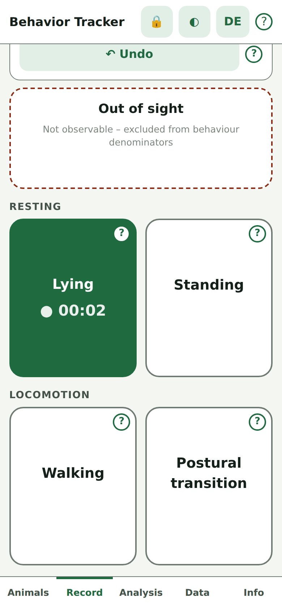

Not sure what a behavior means? Tap the **?** on its button for the definition and an example.

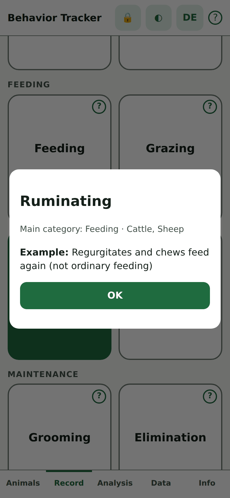

Need everything on one screen? Choose size **S**.

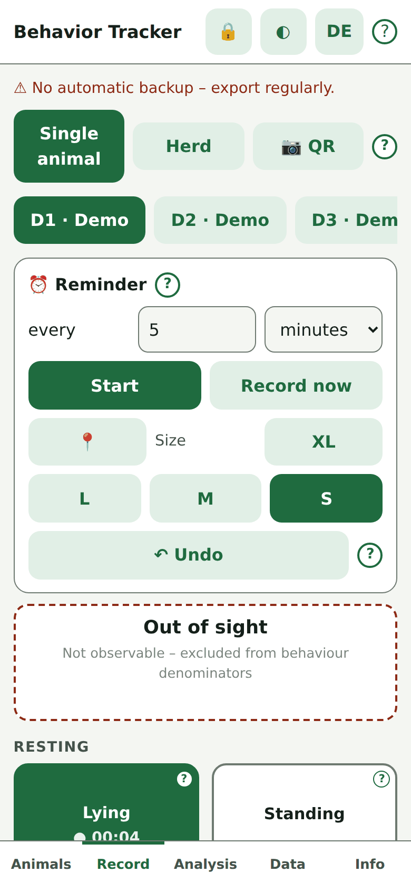

> **Reminder timer:** set "every 5 minutes", press **Start**, and the app prompts you with sound and vibration. Confirm and a snapshot of all animals is stored.

## Step 3: Herd scan (optional)

For scan sampling, switch the mode bar from **Single animal** to **Herd**, then tap **Herd scan**.

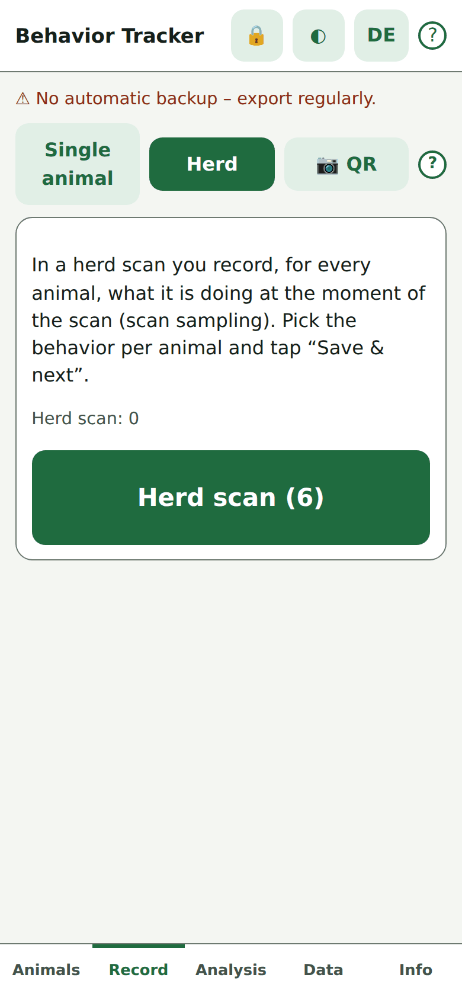

Choose the behavior(s) of each animal at the moment of the scan and tap **Save & next** (or **Skip** if you cannot see it).

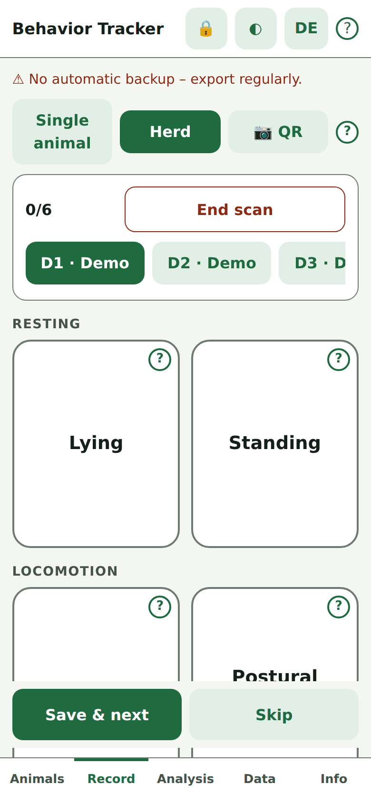

## Step 4: Look at your data

### Tables and Gantt chart

**Analysis → Tables** shows duration and count per behavior by day or hour, a Gantt chart for the selected date, and the welfare-indicator table.

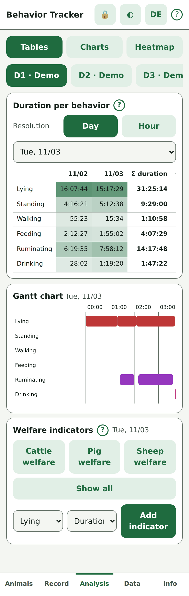

### Charts

**Analysis → Charts** offers five views. Use *Herd mean* and the ✓/✕ chips to decide which animals enter the mean.

| Time budget | Daily pattern |
|---|---|
| 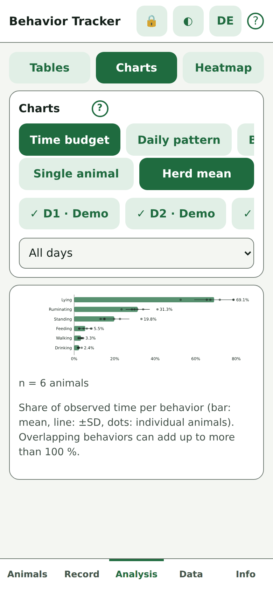 | 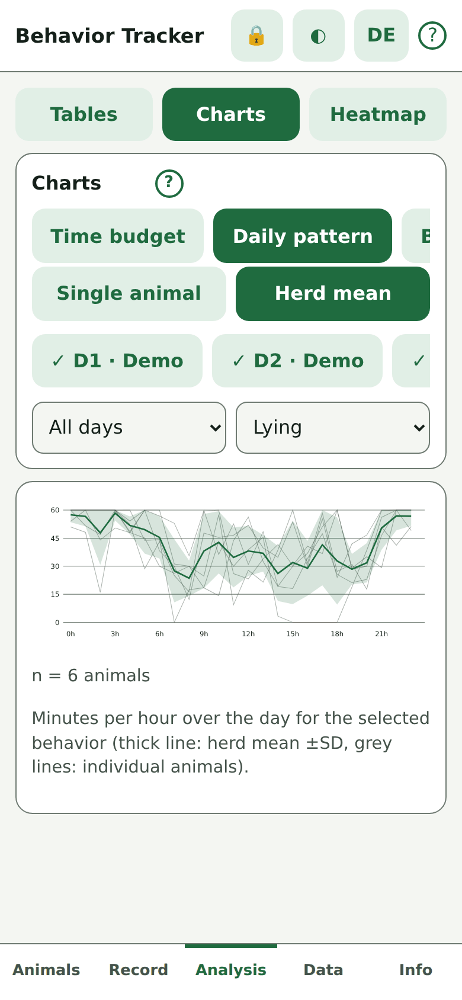 |

| Bouts | Transitions | Synchrony |
|---|---|---|
| 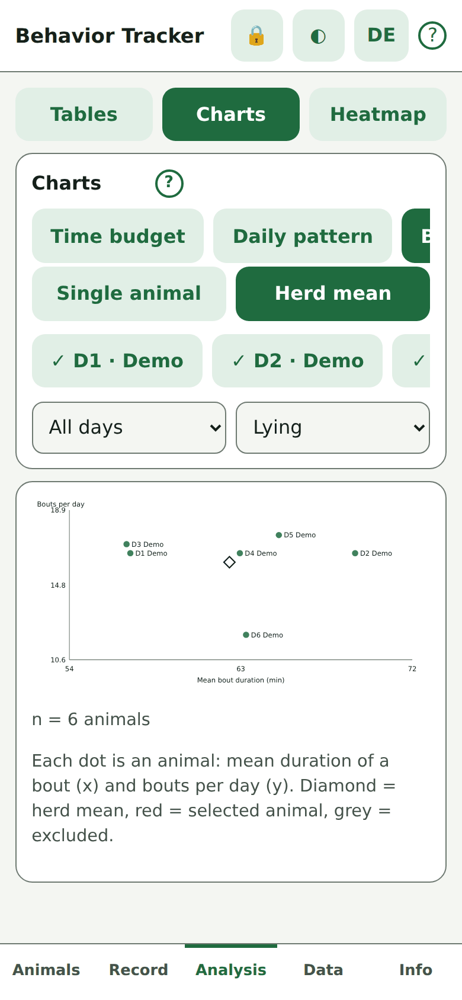 | 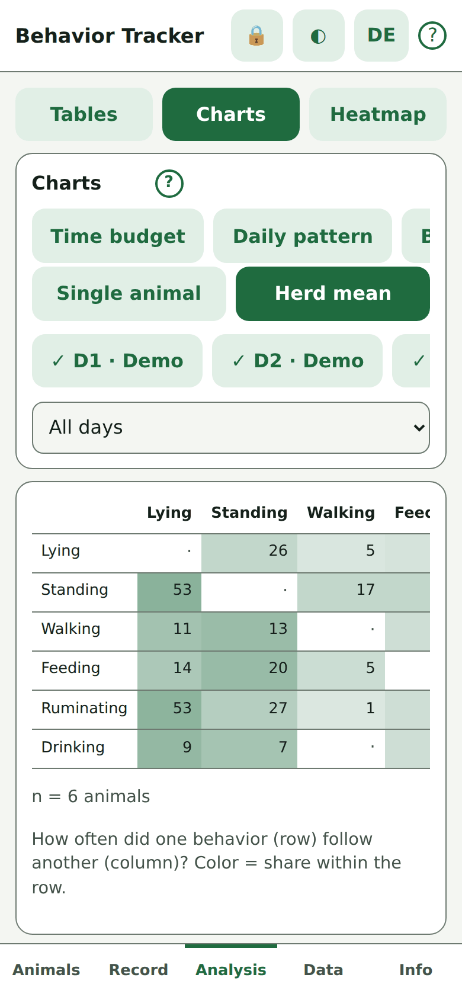 | 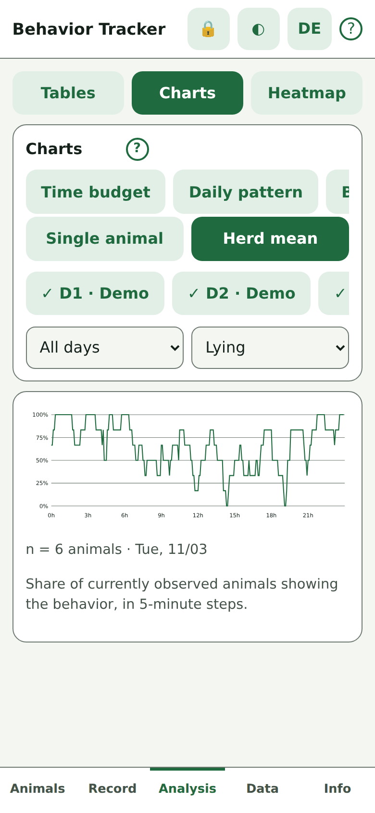 |

### Heatmap

**Analysis → Heatmap** shows time of day against day (or weekday, or week). Choose a metric such as *Dominant behavior* or *Coverage*; tap a cell for details.

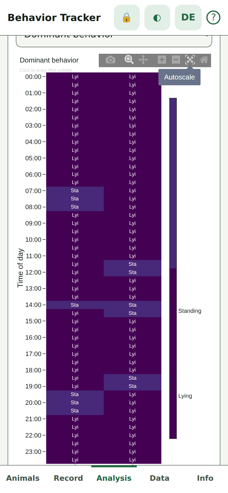

## Step 5: Export and back up

In the **Data** tab export your data as JSON or CSV, merge a colleague's file, or compare your coding with a video using the validation card. The app does not back up automatically, so export at the end of every observation session.

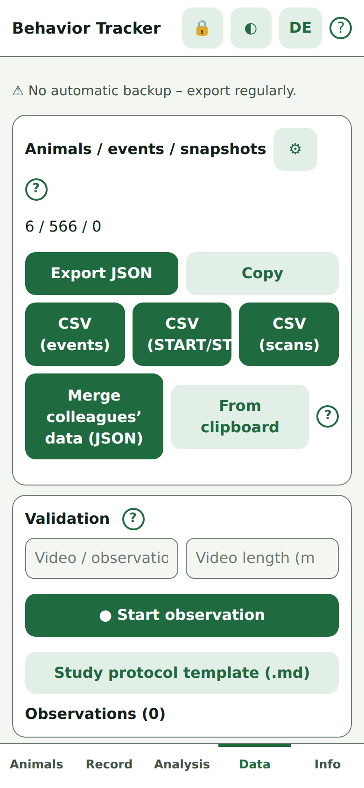

The ⚙ button opens more tools: PDF report, calendar reminders, ethogram import/export, codebook, demo data and the optional secondary backup file.

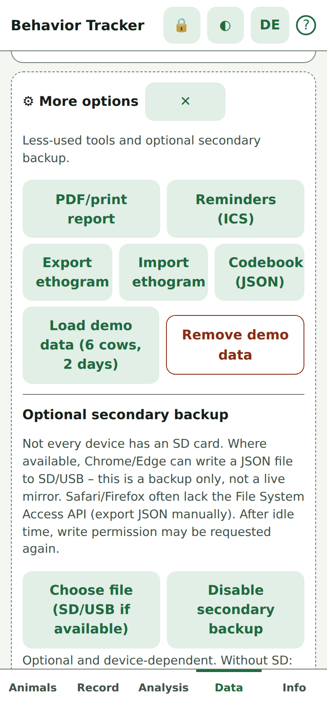

## Field modes

**Outdoor mode** (black/yellow, larger buttons) is made for bright sunlight and work gloves. **Night mode** uses red light so you do not dazzle yourself or the animals. Switch with the theme button in the header (hold for 3 seconds).

| Outdoor | Night |
|---|---|
| 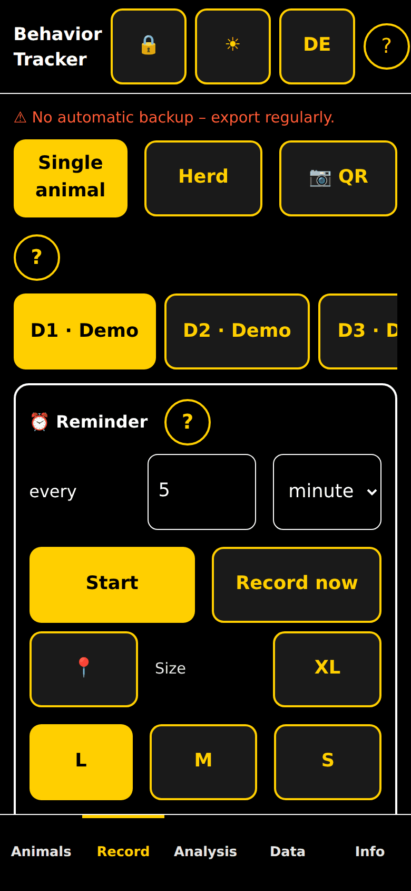 | 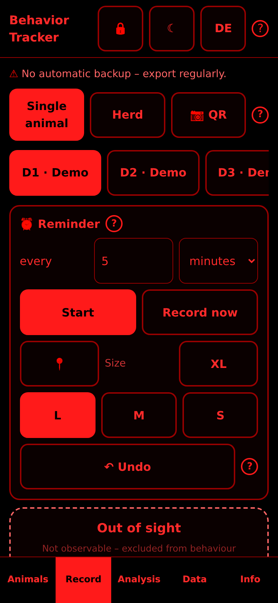 |

The **🔒** button locks the screen. Hold *Hold to unlock* for about 2 seconds to unlock.

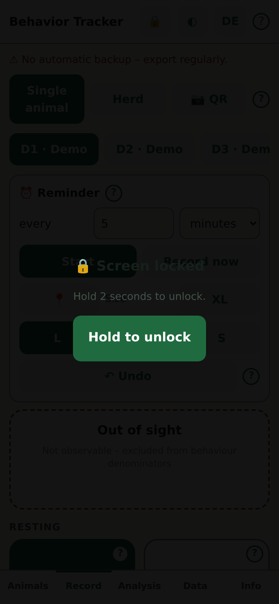

## About

The **Info** tab links to the author's website and the legal notice.

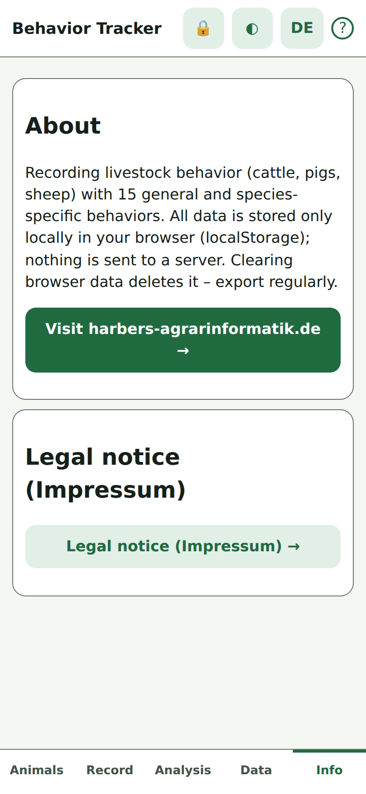

---

*Reproducing these screenshots:* open **Data → ⚙ → Load demo data**, switch the language to English and walk through the tabs as shown above.
